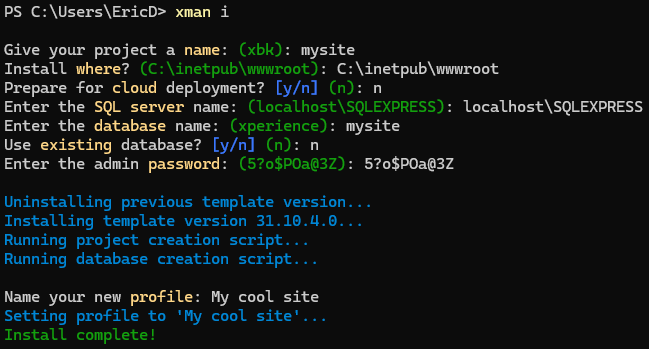
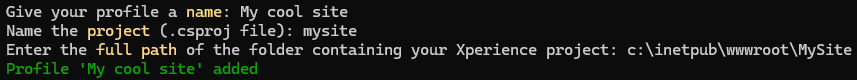

# Xperience Manager (xman)

[](https://www.nuget.org/packages/XperienceCommunity.Manager#versions-body-tab)
[](https://github.com/kentico-ericd/xperience-by-kentico-community-manager/actions/workflows/build.yml)

This tool simplifies the process of installing and managing Xperience by Kentico instances by providing step-by-step wizards with default options provided.



## Requirements

- .NET 10.0 Runtime or newer <https://dotnet.microsoft.com/en-us/download/dotnet/10.0>

## :gear: Installing and updating the tool

Run the following command from a command prompt such as Powershell to install the tool:

```bash
dotnet tool install XperienceCommunity.Manager -g
```

To update to the latest version, run the following command:

```bash
dotnet tool update XperienceCommunity.Manager -g
```

## 🚀 Quick Start

This tool can be run from anywhere, as long as the directory contains the [configuration file](docs/Usage-Guide.md#configuration-file). If there is no configuration file, a new one will be created when you run the tool.

If you already have Xperience by Kentico projects installed, you can run `profile add` to register it with the tool:

```bash
xman p add
```



To install a new instance of Xperience by Kentico, simply run the `install` command:

```bash
xman i
```

## Full Instructions

View the [Usage Guide](docs/Usage-Guide.md) for more detailed instructions.
